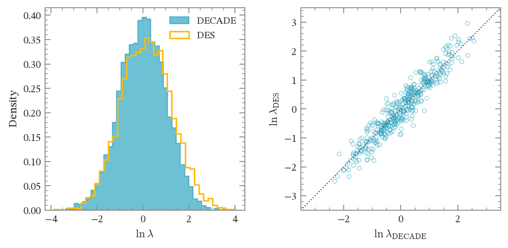
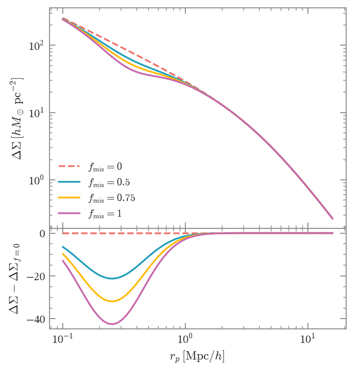
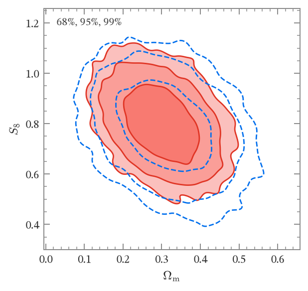
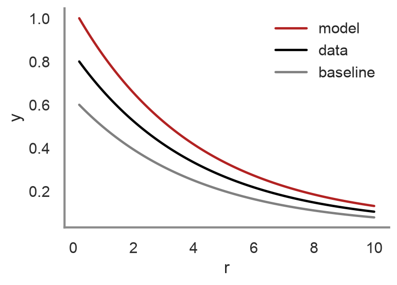
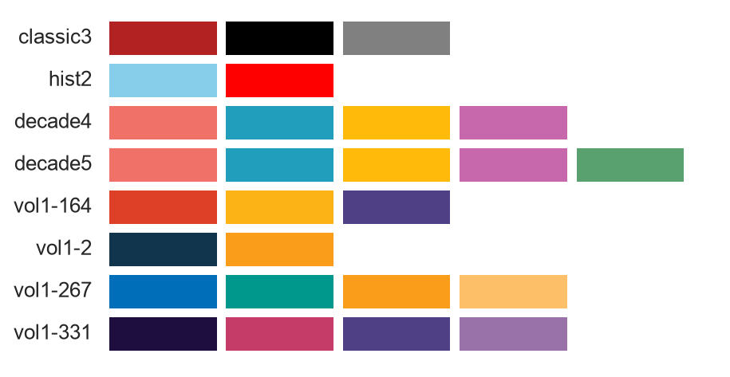
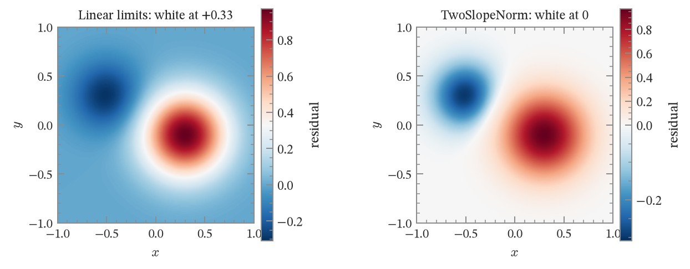

# astro-jolie-plot

[](https://www.python.org/downloads/)
[](LICENSE)
[](#quick-start)
[](#choosing-models)
[](https://matplotlib.org/)

<p align="center">
  
</p>
<p align="center"><em>Paper mode: serif text, Computer Modern math, grey four-sided frame, inward ticks. Synthetic data.</em></p>

Claude skills that make **jolie** figures for astrophysics, then check that a stranger reads them correctly.
Two skills ship together:

- **`astro-jolie-plot`** sets the style: a restrained publication look, curated palettes, and one rule for what a plot is for.
- **`figure-reviewer`** checks the result. A Claude model that sees *only the pixels* says what the figure shows, and you compare that with what you meant.

**The problem:** you cannot review your own figure. You know what it should say, so your eye finds the message even when the figure does not carry it.

**The fix:** hand it to a blind reader. If the reader's one-sentence answer differs from yours, the figure is wrong.

## Why not just look at it yourself?

| Approach | What it catches | What it misses |
|---|---|---|
| Reread your own figure | Typos, unit slips | Anything you silently fill in: unlabeled colors, code-name labels, a misplaced colorbar zero |
| Ask a colleague | A great deal | Costs a colleague's time on every draft |
| **This tool: blind Claude review** | Whether the message survives in the pixels, plus jargon, rainbow colormaps, clipping, midpoint errors | Whether the physics is right |

## Quick start

### Claude Code plugin (skills and reviewer together)

```text
/plugin marketplace add estevesjh/astro-jolie-plot
/plugin install astro-jolie-plot@astro-jolie-plot
```

The reviewer starts with [`uv`](https://docs.astral.sh/uv/) and uses either:

- Claude Code, installed and signed in (backend `claude_cli`, no API key), or
- `ANTHROPIC_API_KEY` in your environment (backend `anthropic_api`).

### Just the plotting helper

```bash
git clone https://github.com/estevesjh/astro-jolie-plot.git
pip install matplotlib seaborn numpy
pip install git+https://github.com/estevesjh/sanzo-wada-colors   # only for 4+ categories
```

```python
import sys; sys.path.insert(0, "astro-jolie-plot/skills/astro-jolie-plot/scripts")
import matplotlib.pyplot as plt
import esteves_plot as ep

ep.apply_style("paper")          # or "daily"
fig, ax = plt.subplots()
...
ep.style_axes(ax)                # grey box, inward ticks
ep.save_fig(fig, "figure")       # PNG at 220 dpi; PDF only with pdf=True
```

## What it does

- **Two modes.** `daily` (seaborn `white` and `talk`, for notes and notebooks) and `paper` (serif, Computer Modern math, grey boxed frame with inward major and minor ticks, capless error bars).
- **Palettes with a rule.** `["firebrick", "black", "grey"]` for two or three categories. Curated presets and real [Sanzo Wada](https://github.com/estevesjh/sanzo-wada-colors) combinations beyond that. No `tab10`, no arbitrary hex codes.
- **Plot recipes.** Step histograms, open-ring scatters, 68/95/99% contours, zero-gap stacked panels, diverging maps anchored at zero.
- **A blind two-phase review.** Phase 1 scores whether the figure communicates. Phase 2, unlocked only after Phase 1 passes, checks notation and narrative against your `.tex`.
- **Zero-token checks.** Jargon, banned labels, rainbow colormaps, saturation clipping and colorbar midpoints are tested deterministically, with no model call.

## The one rule

> The goal of a scientific plot is to enhance the differences between things.

- Show effect off against effect on, or a ladder of one parameter, with everything else fixed.
- Plot the quantity that appears in the equation, not a rescaled stand-in.
- One physical question per panel. A residual panel shares the units of the panel above it.
- Run the two-second eye test: can a physicist see the difference without reading the caption?
- Less is more: one panel, or two or three. No gridlines, no legend boxes.

<p align="center">
  
</p>
<p align="center"><em>A parameter ladder. The lower panel shows the raw difference in the same units, with zero gap between panels. Synthetic profile.</em></p>

## Gallery

All figures are made by [`examples/make_gallery.py`](examples/make_gallery.py) from synthetic data. Run it to regenerate them.

| | |
|---|---|
| <br>**Contours.** Filled for the primary result, dashed and unfilled for the comparison. | <br>**Daily mode.** Firebrick for the prediction, black for data, grey for the baseline. |
| <br>**Palettes.** Role presets and Sanzo Wada plates. | <br>**The midpoint bug.** See below. |

## Talking to it: prompt cookbook

You do not call tools by hand. Ask Claude in plain English.

### Make a figure

- *"Plot this catalog comparison in paper mode."*
- *"Make an effect-off versus effect-on figure for the miscentering systematic, with a matched residual panel."*
- *"Five richness bins, daily mode, pick a Sanzo Wada palette."*

### Review a figure

- *"Blind-review `figures/dsigma_ladder.png`. The intended message is: miscentering suppresses the profile inside 1 Mpc/h and leaves the outer profile unchanged."*
- *"Review all the PNGs in `figures/` in parallel and tell me which ones fail Phase 1."*
- *"Phase 1 passed. Now run Phase 2 against `draft/main.tex` and `notes/notation.md`."*

### Change the models

- *"Use the deep model for this review."*
- *"Use `claude-haiku-5-5` for quick triage."*

## Why a blind review works

We all check our figures. We reread the axes, fix the labels and confirm the units. The trouble is that the person checking is the wrong instrument. You know what the figure is supposed to show, so your eye finds it even when the figure does not say it.

Readers do not supply that. They give a figure a few seconds. If the message is not in the pixels, they leave with the wrong message or none, and the referee writes "unclear." You find out late, when a change is expensive.

So the figure goes to a reader who has only the pixels, and the answer is compared with your intent.

### It is a blinded experiment

You would not let the experimenter who knows which sample was treated grade the result. Each habit below comes straight from the lab.

| In the lab | In the review |
|---|---|
| **Blind the observer.** | Reviewer 1 sees only the image, with metadata stripped, plus the caption if you give one. It never sees the manuscript, the project or the filename. |
| **Separate experimenter from grader.** | The plotting agent never certifies its own figure. A different reader looks at it, and you compare its one-sentence conclusion with your intent: `MATCH`, `PARTIAL_MISMATCH` or `MISMATCH`. |
| **Fix the pass criteria before you measure.** | The gate is written into the tool. To pass, the conclusion must match, the score must reach 80, no deterministic check may fire and no critical visual defect may remain. |
| **Calibrate with an instrument that does not drift.** | Zero-token checks give the same answer for the same figure. Model results are cached on the stripped pixels and caption. |
| **Test the part before the system.** | Phase 2 stays locked until Phase 1 passes. The figure must survive alone before it is checked against the manuscript. |

### A bug you cannot see but a stranger can

Take a diverging colormap for a residual map. You choose limits of −0.31 to +0.97 and let matplotlib spread the colors linearly. White now sits at +0.33, not at zero (left panel).

<p align="center">
  
</p>

You do not notice, because you know zero means no residual. A stranger reads the colorbar ticks and concludes that +0.33 is the null. A deterministic check on the midpoint arithmetic blocks the figure. The fix is one line: `TwoSlopeNorm(vmin, vcenter=0.0, vmax)` (right panel).

### A real run

Reviewer 1 was given only the ladder figure above, with the default model (`claude-sonnet-5-5`, through the `claude` CLI). It answered in about 11 seconds:

> Increasing f_mis suppresses ΔΣ at r_p ≲ 1 Mpc/h (max deficit ≈ −43 near 0.25 Mpc/h) while leaving r_p ≳ 2 Mpc/h unchanged.

That is the message the figure was built to carry. Had the answer been different, the figure would have needed work.

### What it can and cannot tell you

- The reviewer is a language model. It stands in for a careful, unprimed reader and does not replace one. Show important figures to a human colleague too.
- It tests whether a figure communicates. It does not test whether the physics is right. A clear figure of a wrong result passes.
- Its verdict is only as useful as your stated intent. If you cannot write the intended conclusion in one sentence, the figure is not ready for any reviewer.

## Review scoring

| Phase | Reader sees | Score |
|---|---|---|
| **1. Blind** | Stripped image and optional caption | Conclusion accuracy (0 to 40), variable clarity (0 to 35), visual design (0 to 25) |
| **2. Context** | Image, `.tex`, notation table | Notation hygiene (0 to 50), narrative alignment (0 to 50) |

The final score is the mean of the two phases, capped at 74 if either fails. Verdicts: `READY_FOR_PAPER`, `REVISE_TEX`, `REVISE_CAPTION`, `REDO_FIGURE`.

## Choosing models

| Variable | Effect | Default |
|---|---|---|
| `FIGURE_REVIEW_MODEL` | model for `speed="fast"` | `claude-sonnet-5-5` |
| `FIGURE_REVIEW_DEEP_MODEL` | model for `speed="deep"` | `claude-opus-5-5` |
| `FIGURE_REVIEW_BACKEND` | `claude_cli` or `anthropic_api` | first one available |

`claude-haiku-5-5` is a cheaper choice for quick triage. Backends and details: [`mcp/figure-reviewer/README.md`](mcp/figure-reviewer/README.md).

## Repository layout

```text
skills/astro-jolie-plot/   SKILL.md and the esteves_plot.py helper
skills/figure-reviewer/    SKILL.md for the blind review
mcp/figure-reviewer/       the MCP server (Python), Anthropic backends only
examples/make_gallery.py   regenerates every figure in docs/images
.mcp.json                  starts the server when installed as a plugin
.claude-plugin/            plugin and marketplace manifests
```

Run the server's tests:

```bash
uv run --directory mcp/figure-reviewer --with pytest --with pytest-asyncio pytest -m "not live"
```

## Credits

The paper mode follows the figure conventions of the DECADE cluster paper (Anbajagane et al. 2026). Palettes draw on Sanzo Wada's *A Dictionary of Color Combinations*, through [`sanzo-wada-colors`](https://github.com/estevesjh/sanzo-wada-colors).

## License

MIT
